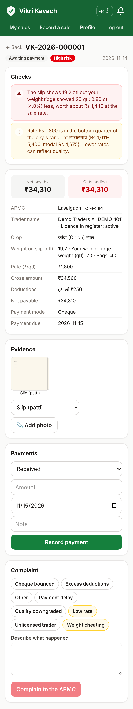

# Vikri Kavach (विक्री कवच): sale shield for APMC farmers

**Track:** Agriculture. Farmer income protection, market access and digital crop-loss assessment.

At an APMC (agricultural market yard), a farmer can lose money after the auction in five common ways:
- a short-weighing scale
- a rate written below the day's auction range
- extra or inflated deductions
- payment delayed for weeks
- a cheque that bounces

The farmer rarely has the records to prove any of it. Vikri Kavach is a mobile-first web app that:

1. **Records every sale in two minutes.** The farmer photographs the slip (*patti*), and AI fills in the form when an Anthropic key is configured. The farmer adds their own weighbridge weight.
2. **Checks the sale automatically, with plain explanations:**
   - **Weight:** the slip weight against the farmer's own weighbridge, with the loss in rupees.
   - **Rate:** against the real MSAMB auction range for that market, crop, variety and day.
   - **Arithmetic:** quantity × rate = gross, and gross − deductions = net.
   - **Deductions:** against the configured charge rules.
   - **Licence:** the trader's licence against the APMC's own register (active, suspended or cancelled).
   - **Payment:** overdue or bounced payments, plus any slip photo reused on another sale.
3. **Runs a payment clock.** A daily job marks unpaid sales overdue and notifies the farmer.
4. **Builds a printable complaint pack.** One tap files a complaint, and the APMC secretary gets the facts, the checks, the payments and timestamped photos with SHA-256 fingerprints.
5. **Gives APMC officers a dashboard.** It shows overdue money by trader, bounced cheques, repeated weight gaps and low-rate patterns, and a complaint queue with status updates that reach the farmer. Officers also maintain the licence register.

Fairness rule: trader status comes **only** from the APMC's official register. Complaints and patterns are leads for officers to verify, and are never shown to the public as a blacklist.

| Farmer: sale checks (phone) | APMC officer dashboard |
|---|---|
|  |  |

More screens are in [`docs/screenshots/`](docs/screenshots/):
- Marathi login
- new sale form
- my sales
- evidence pack
- complaint handling
- licence register
- farmer notification

## Architecture

```
Browser (React 19 + Vite + Tailwind 4, Marathi / English)
   │  same-origin cookie session (HttpOnly JWT) + CSRF header
   ▼
One container on port 8080 (gunicorn + uvicorn workers)
   ├─ FastAPI API (/api/*)  ── PostgreSQL (Amazon RDS)
   ├─ React app (static)     ── S3: evidence photos (private, SSE)
   └─ daily jobs thread      ── Amazon SNS: OTP SMS
         ├─ MSAMB prices for 22 crops (live msamb.com data, via the vendored bhavsetu package)
         └─ overdue payments → notifications
```

- **Daily jobs on many containers.** Each daily job claims a unique `(job, date)` row, so it runs once per day however many containers are up. If a container dies mid-job, another takes the claim over after 30 minutes.
- **Startup with many workers.** Table creation and the demo seed run under a PostgreSQL advisory lock, so several workers or tasks can start at once.
- **Farmer login.** Phone OTP: codes are HMAC-hashed, limited to 5 per hour and 5 attempts, and expire after 10 minutes. **APMC staff login:** username and scrypt-hashed password. Officers see only their own APMC.
- **Uploads.** Type is checked by magic bytes (JPG, PNG, WebP, PDF), up to 10 MB.
- **Audit.** Every write is logged to an audit table.

## Deploy to AWS from CloudShell (one command)

1. Sign in to the AWS console, choose a region (for example **Asia Pacific (Mumbai) ap-south-1**), and open **CloudShell** (the `>_` icon in the top bar).
2. Run:

```bash
git clone https://github.com/akashtalole/Vikri-Kavach.git && cd Vikri-Kavach
```

```bash
./cloudshell/deploy.sh --demo-apmc 02190400
```

The deployment takes about 15–20 minutes, most of it waiting for the database. At the end it prints the app's `https://` URL. The script creates or reuses everything the app needs:

| Step | AWS resource |
|---|---|
| Database | RDS PostgreSQL `db.t4g.micro`: private, encrypted, 7-day backups, deletion protection |
| Evidence | S3 bucket: private, encrypted, versioned |
| Image | Built by Docker in CloudShell, or by AWS CodeBuild when CloudShell can't; pushed to ECR (last 10 kept) |
| Secrets | Secrets Manager: `JWT_SECRET`, `DATABASE_URL`, and the optional Anthropic key and demo password |
| Permissions | Execution role (reads only this app's secrets); task role (this bucket and SNS SMS only); Express infrastructure role |
| App | **ECS Express Mode** service: Fargate with 1 vCPU / 2 GB, HTTPS load balancer, health check `/api/health`, 1–4 tasks on CPU, CloudWatch logs |

Run it again after `git pull` to roll out a new version. The database, secrets and evidence are kept.

| Option | Meaning |
|---|---|
| `--demo-apmc CODE` | Demo officer `demo-officer` plus a sample register for that APMC. The script prints how to read the password. |
| `--otp sns` / `--otp dev` | Send login codes by SMS, or show them on screen (demos only). If the account's SNS SMS is still in the sandbox, the script warns you and offers `dev`. |
| `--ai-key` | Prompts for an Anthropic API key and turns on AI slip reading |
| `--build docker` / `--build codebuild` | Where to build the image (default: Docker if available) |
| `--database-url URL` | Use an existing PostgreSQL instead of creating RDS |
| `--region REGION`, `--db-class CLASS`, `--yes` | Region, RDS size, no questions |

### Operating it

The database is private, so admin commands run as one-off tasks inside the VPC. A staff password is hashed in CloudShell and never sent in plain text.

```bash
./cloudshell/admin.sh apmc-codes nashik
```

```bash
./cloudshell/admin.sh create-staff --username lasalgaon-secretary --apmc-code 02190400 --name "APMC Secretary"
```

```bash
./cloudshell/admin.sh import-traders --apmc-code 02190400 register.csv
```

```bash
./cloudshell/status.sh
```

```bash
./cloudshell/logs.sh
```

```bash
./cloudshell/destroy.sh
```

- `apmc-codes` finds an APMC's code.
- `create-staff` creates an officer account, or resets an existing one's password.
- `import-traders` loads the official licence register from a CSV with the columns `licence_no,name,firm,status`.
- `status.sh` shows the URL, health, tasks, database and recent events.
- `logs.sh` follows the CloudWatch logs.
- `destroy.sh` removes everything. It keeps a final database snapshot. The evidence bucket is deleted only with `--delete-evidence`.

**Before real farmers use it:** move SNS SMS out of the sandbox, and for India complete DLT sender registration. Then deploy with `--otp sns`. Real APMCs load their own licence register and should not use `--demo-apmc`.

**Costs** come mainly from the RDS instance, one always-on Fargate task, and the load balancer. Run `./cloudshell/destroy.sh` after a demo.

## Run locally

With Docker (Postgres + app at http://localhost:8080; demo officer `demo-officer` / `demo-officer-pass`):

```bash
docker compose up --build
```

Without Docker:

```bash
pip install "./bhavsetu" "./backend[dev]"
```

```bash
cd frontend && npm ci && npm run build
```

```bash
cd backend && STATIC_DIR=../frontend/dist uvicorn app.main:build --factory --port 8080
```

In dev mode (`OTP_MODE=dev`) the OTP is shown on screen. For frontend work, run `npm run dev` (it proxies `/api` to port 8080).

Tests: `cd backend && pytest -q` (15 tests) and `pytest -q bhavsetu/tests` (10 tests).

### Configuration

| Variable | Default | Purpose |
|---|---|---|
| `DATABASE_URL` | `sqlite:///var/vikrikavach.db` | PostgreSQL in production |
| `JWT_SECRET` | dev value | Required, 32+ characters, when `APP_ENV=production` |
| `APP_ENV` | `development` | `production` turns on secure cookies, SMS OTP and hides API docs |
| `OTP_MODE` | `dev` / `sns` | `sns` sends OTP by Amazon SNS SMS |
| `S3_BUCKET` | empty (local disk) | Evidence storage |
| `ENABLE_SCHEDULER` | `false` | Daily price import and overdue marking |
| `WEIGHT_TOLERANCE_PCT` | `0.5` | Weight gap allowed before flagging |
| `PAYMENT_DAYS_DEFAULT` | `1` | Due date when the slip gives none |
| `ANTHROPIC_API_KEY` | empty | Enables AI slip reading |
| `DEMO_APMC_CODE` + `STAFF_PASSWORD` | empty | Seeds `demo-officer` and three sample register entries |

## Verified

- Image built and run with 3 workers against PostgreSQL 17.
- Imported 2,933 live MSAMB price rows across 22 crops.
- Ran the full farmer → officer → farmer flow in Chromium with Playwright: OTP login, three sales, slip photo upload, bounced cheque, complaint, officer resolution, and the farmer notification.
- The screenshots come from that run.
