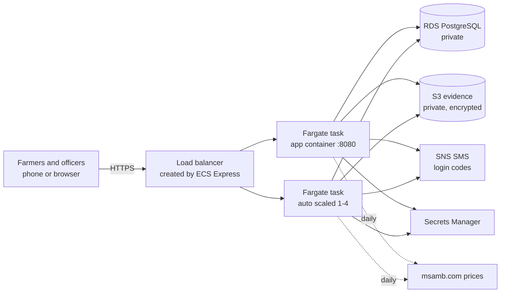

# Deploy

| Option | Best for | Guide |
|---|---|---|
| **AWS CloudShell → ECS Express Mode** | A real or pilot deployment with HTTPS, a managed database and auto scaling | [One-command deploy](cloudshell.md) |
| **Docker Compose** | A laptop demo or development | [Run locally](local.md) |

After deploying, see [Operating the service](operations.md) to add APMC officers, load licence registers and roll out updates. Before real farmers use it, work through the [go-live checklist](go-live.md).

