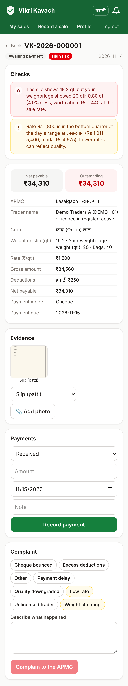
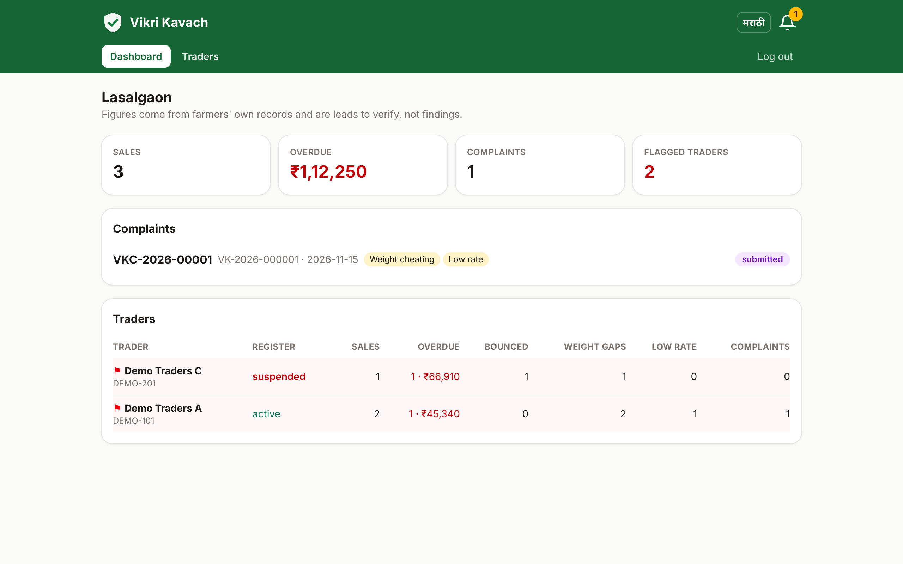
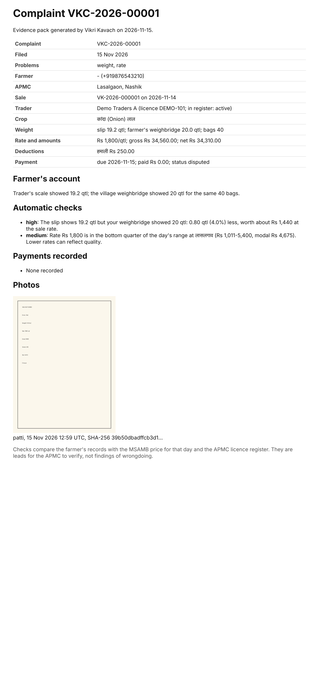

---
hide:
  - navigation
---

# Vikri Kavach · विक्री कवच

A sale shield for farmers at Maharashtra's APMC markets. It checks every sale for weight, rate, deduction and payment fraud, and turns a problem into evidence the APMC can act on.

[Deploy to AWS in one command](deploy/cloudshell.md){ .md-button .md-button--primary }
[See how it works](product/how-it-works.md){ .md-button }

## The problem

The auction at an APMC (agricultural market yard) is public, but much of what follows it is not. A farmer can lose money in five common ways:

- **Short weighing** on the trader's scale.
- **A low rate** written on the slip (*patti*), below the day's auction range.
- **Extra or inflated deductions**, such as *hamali*, weighing, commission or "advance recovery".
- **Late payment**, often by weeks.
- **A cheque that bounces.**

The farmer rarely has the records to prove any of it, and the APMC office cannot act on a complaint without facts.

## What Vikri Kavach does

-   :material-camera: **Record a sale in two minutes**

    ---

    Photograph the slip and the form fills itself (AI, optional). Add your own weighbridge weight.

-   :material-shield-check: **Automatic checks**

    ---

    The sale is checked on weight, the rate against live MSAMB prices, the arithmetic, the deductions, the trader's licence, the payments and reused photos. Each finding is explained in plain words. [Details](product/checks.md)

-   :material-clock-alert: **Payment clock**

    ---

    A daily job marks unpaid sales overdue and notifies the farmer. Bounced cheques are recorded against the trader.

-   :material-file-document-check: **Complaint pack**

    ---

    One tap files a complaint. The APMC gets a printable pack with the facts, the checks, the payments and timestamped photos with SHA-256 fingerprints.

-   :material-view-dashboard: **Officer dashboard**

    ---

    Officers see overdue money, bounced cheques, repeated weight gaps and low-rate patterns for each trader. They work a complaint queue whose updates reach the farmer.

-   :material-scale-balance: **Fair to traders**

    ---

    A trader's status shown to farmers comes **only** from the APMC's official licence register. Patterns are leads for officers to verify, never a public blacklist.

## See it

<figure markdown><figcaption>Farmer: checks on a sale (phone)</figcaption></figure>
<figure markdown><figcaption>APMC officer: patterns by trader</figcaption></figure>
<figure markdown><figcaption>Printable complaint evidence pack</figcaption></figure>

[All screens](product/screens.md)

## Built for real deployment

- **One container:** FastAPI and the React app together, on port 8080.
- **AWS services:** PostgreSQL on Amazon RDS, evidence photos in S3, SMS login codes through Amazon SNS.
- **Deployment:** to **Amazon ECS Express Mode** from AWS CloudShell, with [one command](deploy/cloudshell.md). That gives an HTTPS load balancer, auto scaling and logs.
- **Live market data:** prices for 22 crops from msamb.com, refreshed daily. The register covers all 309 Maharashtra APMCs.
- **Languages:** Marathi first, with English. The UI is mobile-first.
