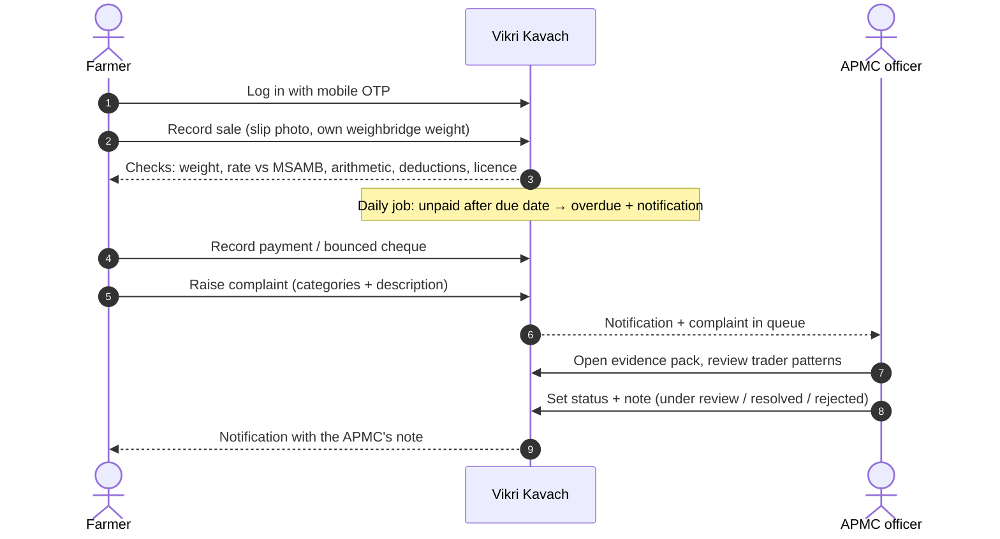

# How it works

## For the farmer

1. **Log in** with a mobile number and a 6-digit code sent by SMS. No password is needed.
2. **Record a sale** as soon as the slip is in hand:
    - **Photo:** if AI slip reading is on, the slip photo fills the form. The photo is also saved as evidence.
    - **Where and who:** the APMC (all 309 Maharashtra APMCs are listed), the trader's licence number (checked against the register as you type) and the crop.
    - **Numbers:** your **own weighbridge weight** next to the **slip weight**, the rate, the deductions, the payment mode and the due date.
3. **See the checks.** Each sale gets a risk level (high, needs attention, or looks fine) and a list of findings in plain language. See [Fraud checks](checks.md).
4. **Add evidence:**
    - the weighbridge receipt
    - the cheque
    - produce photos
5. **Track the payment.** Record money received, a promise or a bounced cheque. Overdue sales are flagged automatically.
6. **Complain** in one tap. The problem categories the checks found are suggested. The complaint goes to the officers of that APMC, and the farmer can open the same printable evidence pack.

## For the APMC officer

- **Dashboard.** For each trader at the officer's APMC, it shows:
    - sales
    - overdue count and amount
    - bounced cheques
    - sales with weight gaps and low rates
    - complaints

    A trader is **flagged** when a pattern appears: two overdue sales, any bounced cheque, two weight gaps, or low rates on half of four or more sales.
- **Complaint queue.** Each complaint shows the sale, the checks and the evidence pack. Setting the status and a note notifies the farmer.
- **Licence register.** Officers enter or import the APMC's official register, with each licence marked active, suspended or cancelled. Earlier sales that used a licence number are linked automatically once that trader is added.

!!! note "Leads, not verdicts"
    Dashboard figures come from farmers' own records. They help officers decide where to look. The APMC verifies them before acting.
