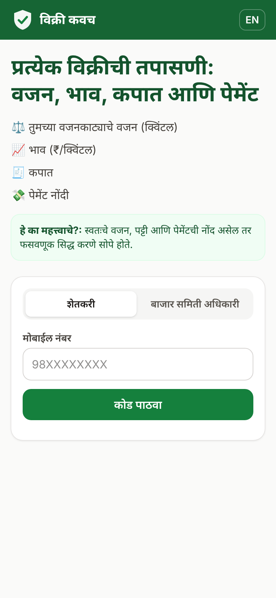
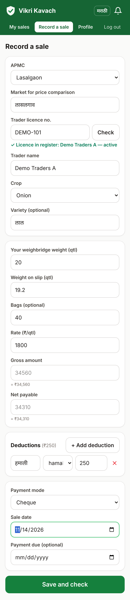
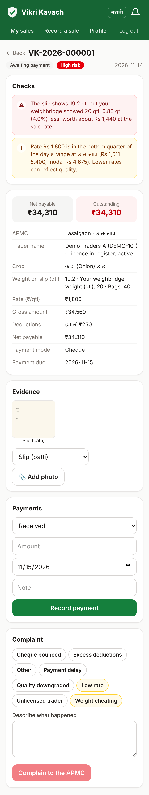
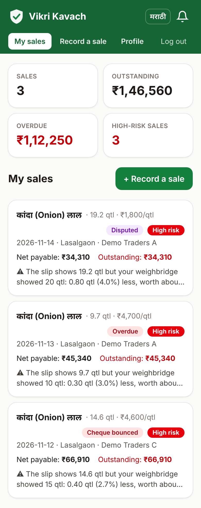
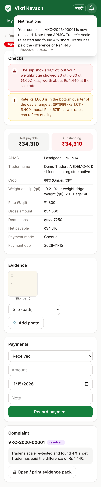
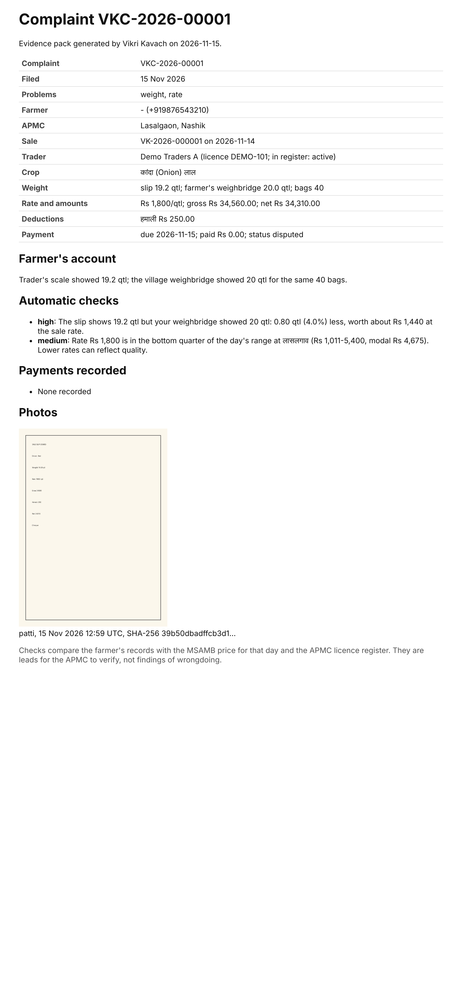
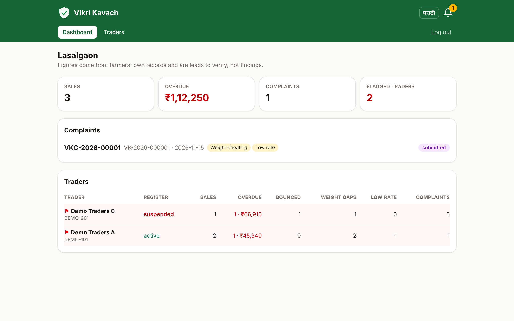
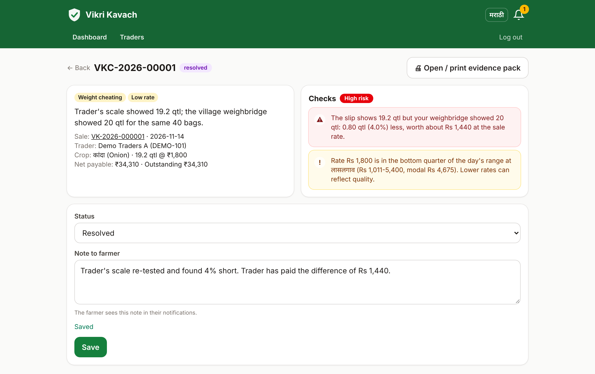
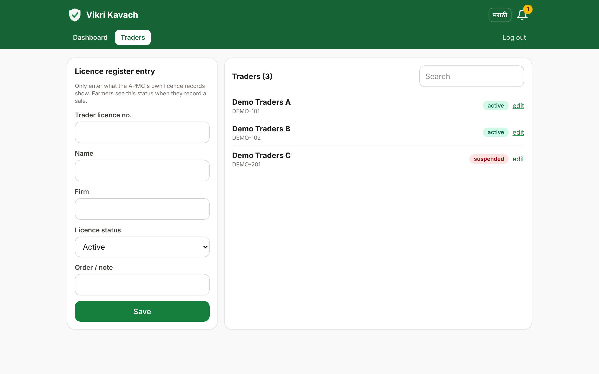

# Screens

These screenshots come from an end-to-end browser run against the real app, with live MSAMB prices in PostgreSQL. Trader names are demo data.

## Farmer (phone)

<figure markdown><figcaption>1. Login in Marathi with a mobile OTP</figcaption></figure>
<figure markdown><figcaption>2. Recording a sale</figcaption></figure>
<figure markdown><figcaption>3. Checks: weight gap ₹1,440, rate in the bottom quarter</figcaption></figure>
<figure markdown><figcaption>4. My sales with outstanding and overdue totals</figcaption></figure>
<figure markdown><figcaption>9. The APMC's resolution reaches the farmer</figcaption></figure>

## Evidence pack

{ width="640" }

## APMC officer (desktop)

