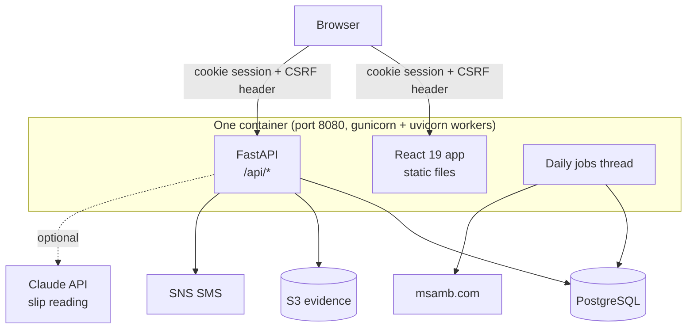
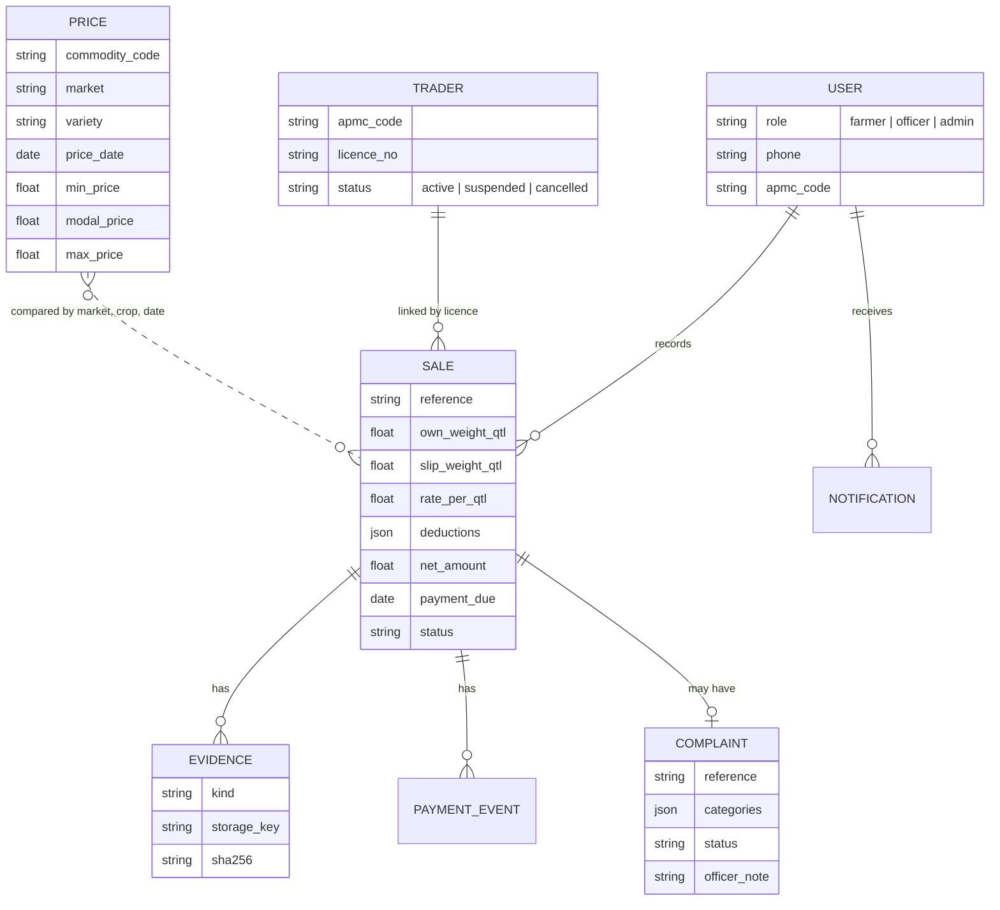

# Architecture

## Code layout

| Path | Contents |
|---|---|
| `backend/app/main.py` | API routes, authentication, the complaint pack, serving the static app |
| `backend/app/checks.py` | All fraud checks (see [Fraud checks](../product/checks.md)) |
| `backend/app/jobs.py` | Price import, overdue marking, daily scheduler with a claim on each job |
| `backend/app/models.py` | SQLAlchemy models |
| `backend/app/services.py` | S3 or disk storage, SNS or dev SMS, the Claude client |
| `backend/app/security.py` | Phone normalisation, scrypt passwords, HMAC-hashed OTPs, JWT |
| `backend/app/cli.py` | Admin command line |
| `bhavsetu/` | Market-data package (vendored): MSAMB client, APMC master list, slip reading and rules |
| `frontend/src/` | React pages, Marathi and English strings, API client |
| `cloudshell/` | AWS deployment and operations scripts |

## Data model

Other tables:
- `otp_codes`: hashed login codes.
- `job_runs`: one row per job per day.
- `audit`: every write action.

## Running on several containers

- **Daily jobs.** Every task runs the scheduler thread, and each job first claims a unique `(job, date)` row. Only the task that wins the claim runs the job. If a task dies mid-job, its unfinished claim can be taken over after 30 minutes. A finished job is never repeated that day.
- **Startup.** Table creation and the demo seed run under PostgreSQL advisory locks, so workers and tasks can start at the same moment.
- **Sessions.** These are stateless signed cookies, so any task can serve any request.
